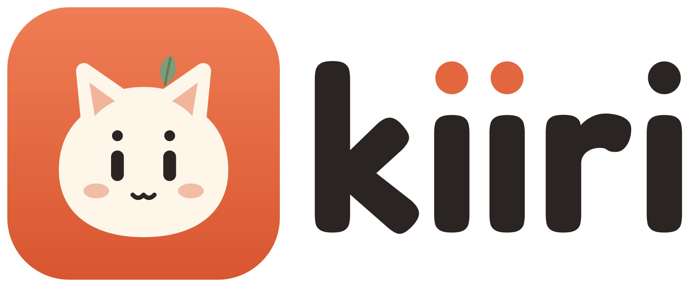

  <picture>
    <source media="(prefers-color-scheme: dark)" srcset="lockup-light.svg">
    
  </picture>

<h3 align="center">A little cat that lives on your desktop.</h3>

  Kiiri keeps you company, watches your coding agents, 
  and when you ask, looks at your screen and points at the answer.

  <a href="https://kiiri.app">Website</a> ·
  <a href="https://github.com/kiiri-app/kiiri/releases/latest">Download</a> ·
  <a href="https://github.com/kiiri-app/kiiri">Source</a> ·
  <a href="https://kiiri.app/press">Press kit</a>

---

| | |
|---|---|
| 🐾 **[kiiri](https://github.com/kiiri-app/kiiri)** | The desktop app. Electron, MIT. macOS · Windows · Linux |
| 🔌 **MCP server** | Ships inside the app. Lets Claude Code, Cursor, Codex and any MCP client make Kiiri talk, point, react or look at your screen |
| 🛰️ **[kiiri-proxy](https://github.com/kiiri-app/kiiri-proxy)** | Self-hosted AI proxy. Your keys on your own Cloudflare Worker, one token per device |
| 🎨 **[kiiri-web](https://github.com/kiiri-app/kiiri-web)** | kiiri.app, the press kit and brand assets |

**Open source, local first.** Everything that runs on your machine is free. Use your own API key, or run fully local with Ollama.

The Kiiri name, logo and mascot are © Kiiri. The code is MIT.
